# oochat for Android

[](https://github.com/openonion/oochat-android/actions/workflows/build.yml)
[](https://github.com/openonion/oochat-android/actions/workflows/audit.yml)

Native Android chat client for [ConnectOnion](https://docs.connectonion.com/)
agents, built with Kotlin and Jetpack Compose. Connect to an agent by its `0x…`
address and talk to it — the same protocol the
[web client](https://github.com/openonion/oo-chat) speaks.

## Who this is for

This is a starting point, not a finished product you are meant to use as-is.

If you are running ConnectOnion agents and your users want a native Android app
rather than a browser tab, fork this, change the four things under
[Make it yours](#make-it-yours), and ship it. The web client is the default
answer; this exists for when the default is not enough.

## What it does

### Start from one clear question

A new chat opens on a single, prominent box, with a few suggestions to start
from. The approval mode and the session's settings sit right in it, and the
agent's own Home page is a tab away. Light and dark themes both follow one
design system.

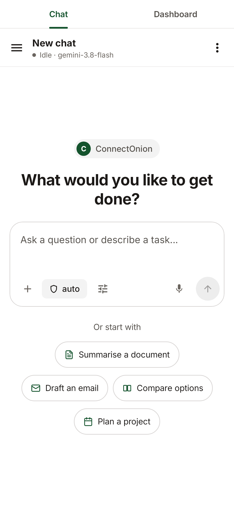 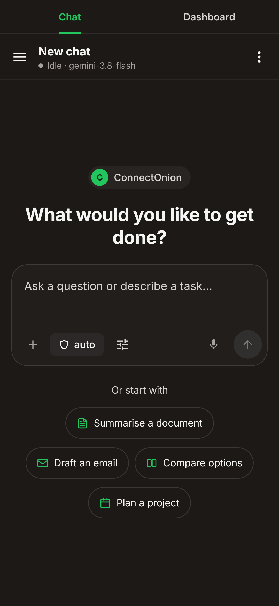

### Slash-command palette

Type `/` in the composer and the agent's published skills appear as a list, each
with the description the agent gave it, if any. The list comes from the agent itself, and only
once its Host has let you in, so an agent's skills are never shown to someone
without access. An agent that publishes nothing shows an empty palette rather
than a stale or invented one.

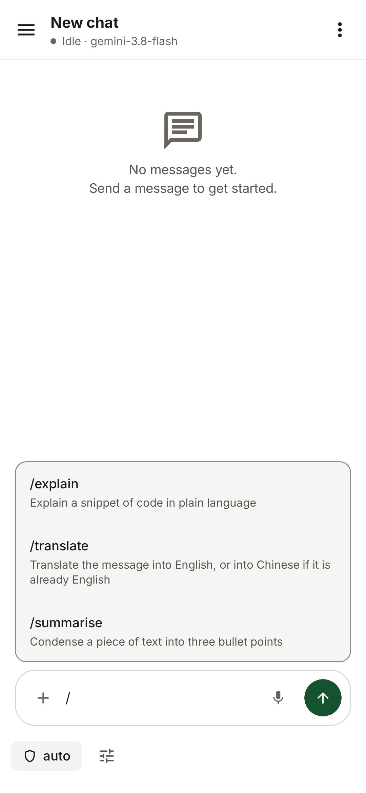

### Dictation lands in the composer, not in the chat

Speak instead of typing and the transcript arrives **in the text field**, where
you can fix a misheard word before anything is sent. A recogniser that mishears a
name no longer costs you a message.

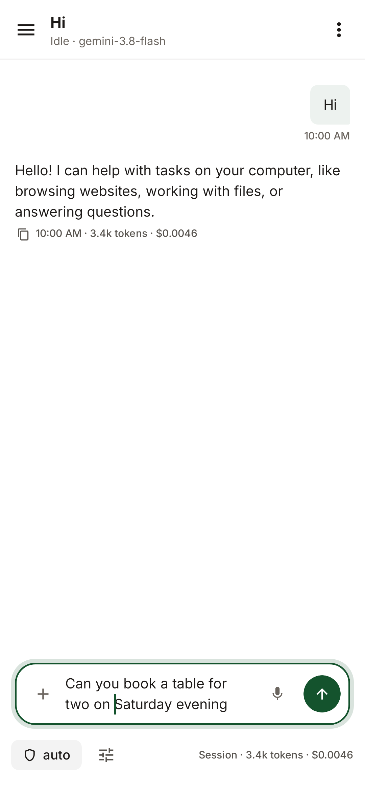

### Keep typing while the agent is working

The composer stays usable while a reply is streaming, so a follow-up or a
correction can be sent mid-run. The agent picks it up as part of the same turn.

This needs `runtime_input` on the agent, which is opt-in
(`Agent(plugins=[runtime_input])`). Without it the relay acknowledges the
mid-run message and queues it, and nothing drains the queue.

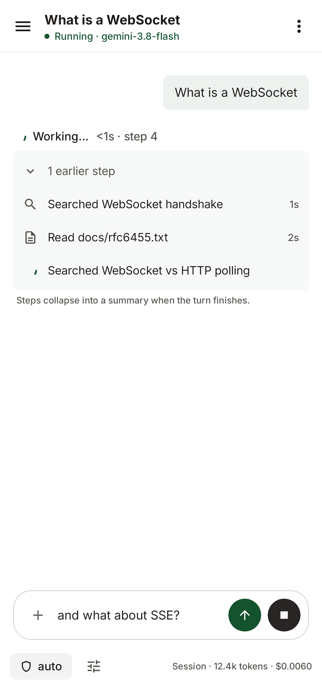

### See what the agent did, without wading through it

While the agent works, its thinking and tool calls appear as steps. Once the
turn is over they fold into one line (how long it worked, how many steps, and
how many failed), with the reply, its tokens and its cost below. Tap the line
to see the steps again.

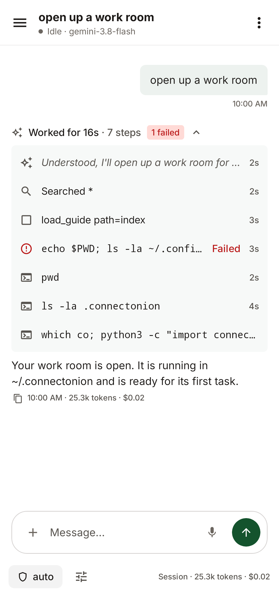

### A message that did not send says so

A message typed while offline waits in the app, survives the app being closed,
and goes out once the connection is back. One that failed is marked, and a tap
sends it again, rather than it disappearing into the transcript as though it
had gone.

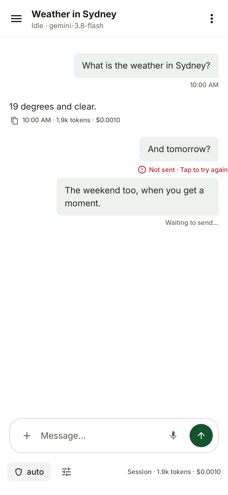

### Claude Code and Codex Work Rooms

When the agent hands a task to Claude Code or Codex, the run gets a Work Room
of its own: its task, its steps, the conversation with the coding agent, and a
Stop that asks you to confirm first. You can type into it, change the coding
agent's permission mode, and resume a finished run with a follow-up, in the
same Claude Code or Codex session. A Claude Code session started in a terminal
says where it stands as it is handed to the app and back. The chat shows a card
for each run, so the conversation stays readable.

When the coding agent asks for permission, the request appears in its room and
in the chat, and answering it in either place settles it.

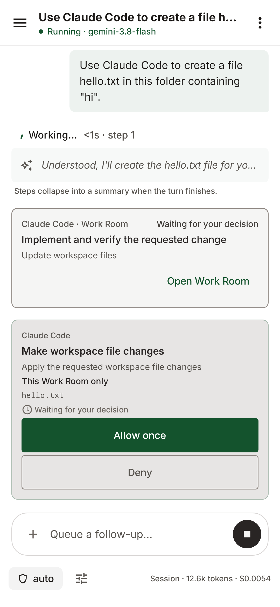 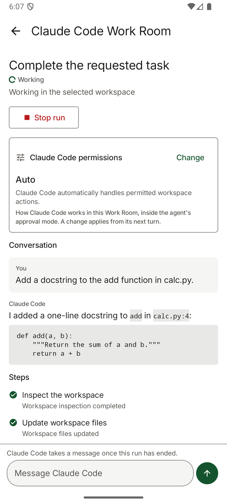

On a tablet the room uses the width:

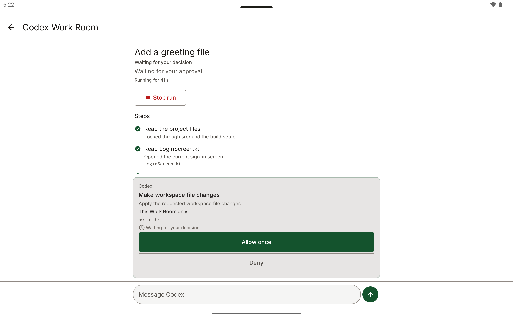

### Told when something needs you

With notifications on, the app tells you when an agent replies, when an
approval is waiting for you, and when a Claude Code or Codex run finishes,
fails or is stopped while you are in another app. Tapping one opens the
conversation, or the Work Room. While a run is going, a quiet notification
keeps the connection open so that these still arrive.

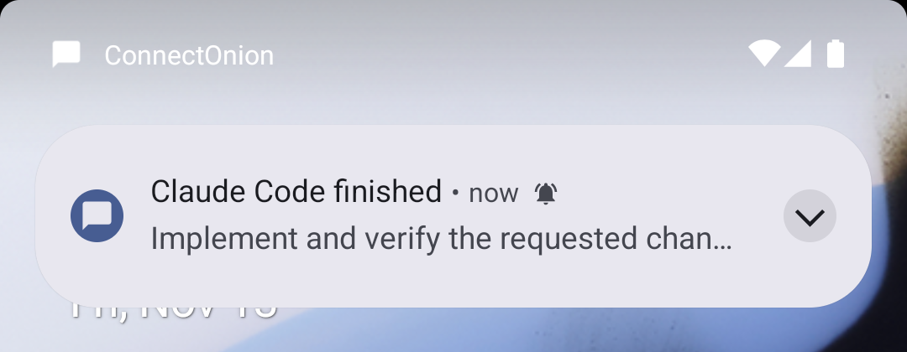

### The agent's own Home page

An agent can publish a Home page: a Dashboard, or a Control Center app whose
buttons start chat turns. On a phone it is a tab beside the chat; on a tablet
or an unfolded foldable it sits next to the chat. The Control Center runs
sandboxed, with no access to the device.

### And the rest

- Multiple sessions per agent, in a drawer, renameable, and the Recent Chat
  list kept in step with the agent's other devices
- Agent discovery, pairing by scanning the website's QR code, and invite codes
- Approval modes for the agent, and for each Claude Code or Codex run
- The agent owner's **Rem** notebook, read-only, as readable Markdown on phone
  and tablet
- Run one of the agent's tools directly, from a form of plain-language fields
  built from the tool's own parameters (needs a Host that sends them), or as
  raw JSON in the developer tools
- Credentials, home folders and raw provider payloads masked wherever they
  would reach the screen, a notification or the logs
- Chat, composer and approval controls labelled for TalkBack
- **BIP39 recovery phrase**, derived with SLIP-0010 the way the connectonion
  SDK does, so a phrase gives the same identity on the phone as in the `co` CLI
  (see [Identity](docs/architecture.md#identity))
- Ed25519 signing via lazysodium, of every command after connecting;
  credentials in EncryptedSharedPreferences (AES256-GCM)
- Room-backed history: agents, sessions, messages, session state

### What it does not do

- Mid-run input needs the agent to opt in (see above)
- A Control Center app gets no device capabilities, and cannot start a new
  conversation
- Instrumented UI tests need an attached device; CI does not run them

## Requirements

| | |
|---|---|
| Android | 8.0 (API 26) or later |
| Build | JDK 17, Android SDK with the API 36 platform |
| Android Studio | Hedgehog (2023.1.1) or newer |
| An agent | See [connectonion](https://github.com/openonion/connectonion) — `pip install connectonion`, then `co init` |

## Build and run

```bash
git clone https://github.com/openonion/oochat-android.git
cd oochat-android

./gradlew :app:assembleDebug        # build
./gradlew :app:installDebug         # install on a connected device or emulator
./gradlew :app:testDebugUnitTest    # unit tests
./gradlew :app:jacocoTestReport     # coverage
```

The regression suite (the core features, plus tests that flag known issues) runs
on its own with `./gradlew :app:testDebugUnitTest -Pregression`; see
[docs/regression-suite.md](docs/regression-suite.md).

Instrumented and Compose UI tests need a device attached:

```bash
./gradlew :app:connectedDebugAndroidTest
```

Screenshot baselines are checked with
[Roborazzi](https://github.com/takahirom/roborazzi):

```bash
./gradlew :app:verifyRoborazziDebug
```

> **CI does not check the baselines**, so re-record them after changing the
> UI: `./gradlew :app:recordRoborazziDebug`. They live in
> `app/src/test/screenshots/`. The same run renders the chat screenshots in
> `screenshots/` that this README and the user guide show
> (`UserGuideScreenshotTest`), so those follow the design too. The rest of
> `screenshots/` were captured on a phone or tablet and are updated by hand.

See [INSTALL.md](INSTALL.md) for a clean-machine walkthrough and
[USER_GUIDE.md](USER_GUIDE.md) for the app itself.

## Configure

| What | Where | Default |
|---|---|---|
| Relay endpoint | In-app settings | `oo.openonion.ai` |
| Agent address | Added in-app by `0x…` address | — |

## Make it yours

| # | What | Where |
|---|---|---|
| 1 | Application ID | `app/build.gradle.kts` — currently `ai.openonion.oochat` |
| 2 | Display name | `app/src/main/res/values/strings.xml` |
| 3 | Icon | `app/src/main/res/mipmap-*` |
| 4 | Relay endpoint | In-app settings, or the default in `Constants.kt` |

## Architecture

Compose UI over view models over a repository layer, with the WebSocket protocol
client underneath. `ui/` renders, `domain/` holds the models, `data/` owns Room
and the preference stores, `network/` owns the relay connection, and `crypto/`
owns the Ed25519 identity and BIP39 recovery.

An architecture test (`ArchitectureGuardTest`) enforces the layering: UI code
cannot import repository implementations, DAOs, or the WebSocket factory
directly. If you restructure, that test is where the rules are written down.

See [docs/architecture.md](docs/architecture.md) and
[docs/protocol.md](docs/protocol.md). [docs/HANDOVER.md](docs/HANDOVER.md)
lists what changed in the 2026 capstone term, how to add a new protocol frame,
and the known gaps.

## Releases

Installable debug-signed APKs are published from semantic version tags. See
[the release guide](docs/RELEASE.md) for the version bump, dry-run and tagging
procedure, and [INSTALL.md](INSTALL.md) for installation and checksum
verification.

A signed release build for internal testers (Google Play internal testing,
Firebase App Distribution, or a direct install) is made with
`scripts/build_internal_release.sh`; see
[docs/internal-testing.md](docs/internal-testing.md).

## Contributing

Issues and pull requests are welcome at
<https://github.com/openonion/oochat-android>.

## License

MIT — see [LICENSE](LICENSE).

Copyright (c) 2026 ConnectOnion PTY LTD.
